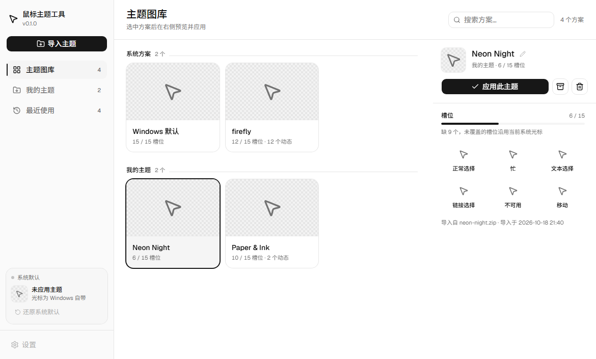
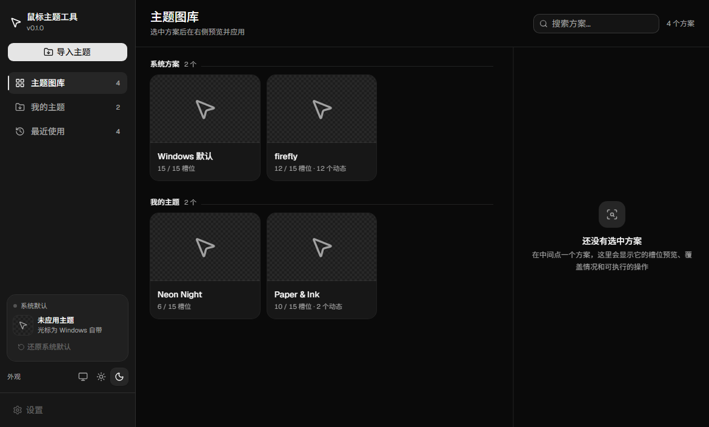

# 鼠标主题工具

一个**不需要管理员权限**的 Windows 光标主题管理器：导入 `.zip` 主题包（或整个主题文件夹）→ 一键应用 → 管理 → 回溯上次用的那个。

系统方案和导入的主题列在一起，应用后立刻生效，光标文件留在原地，不写进 `C:\Windows\Cursors`。

| 浅色 | 深色 |
|---|---|
|  |  |

## 功能

- **导入**：`.zip` 主题包点侧栏按钮选择或直接拖进窗口；解压好的**主题文件夹**也能整个拖进窗口。包内带 `.inf` 安装说明时槽位按说明书对号，没有时按 `arrow`、`busy`、`hand` 这类标准命名推断，自动对上 15 个槽位
- **预览**：静态 `.cur` 与动态 `.ani` 都能在界面里真实播放（Rust 提帧 → canvas 逐帧）
- **应用**：一次写入 15 个槽位并立即刷新系统光标，全程普通用户权限，无 UAC
- **管理**：改名、导出（包内文件按槽位重命名，保证"导出 → 再导入"能还原）、删除
- **回溯**：每次切换记一条历史，按自然日分组，可一键切回
- **还原**：随时回到 Windows 默认光标
- **外观**：跟随系统 / 浅色 / 深色，三态可手动覆盖

## 为什么不直接改 Windows 设置

| 痛点 | 这里的做法 |
|---|---|
| 系统设置只能一套一套换，看不出包里到底有几个光标 | 15 个槽位逐个预览，还标出这个包缺了哪几个 |
| 应用后想切回去，得自己记得上次叫什么 | 历史按天记着，点一下就回去 |
| 网上下载的包解压一堆 `.cur`，不知道该放哪 | 整个文件夹拖进窗口就行；`.zip` 也认。落盘、命名、槽位推断（`.inf` 说明书优先）都由程序做 |
| 改光标要动系统目录 | 只在 `HKCU` 写槽位路径，文件留在 `%LOCALAPPDATA%` |

## 快速开始

前置：[Node.js](https://nodejs.org/) 20+、[Rust](https://www.rust-lang.org/tools/install)、WebView2（Win11 自带）。

```bash
npm install
npm run tauri dev      # 开发（前端热更新 + Rust 增量编译）
npm run tauri build    # 打包
```

只想看界面、不碰系统光标：

```bash
npm run dev            # 浏览器打开 http://localhost:1420，走内置示例数据
```

## 数据与隐私

- 主题存在 `%LOCALAPPDATA%\CursorStudio\themes\<uuid>\{theme.json, cursors/}`
- 历史存在 `%LOCALAPPDATA%\CursorStudio\history.json`（上限 50 条，只存名称快照）
- 卸载不删数据；程序不联网

## 技术栈

Tauri 2（Rust + WebView2）· React 19 · TypeScript · Vite 7 · Tailwind CSS 4 · shadcn/ui（[base-ui](https://base-ui.com)）· zustand 5

## 项目结构

```
src/
├── components/
│   ├── layout/       骨架：侧栏、页头、分隔条、错误与空状态
│   ├── views/        三个页面各自的视图（网格 / 表格 / 时间轴）
│   ├── theme/        主题卡片、检查器、改名与删除
│   └── cursor/       光标预览：单帧、动态播放
├── lib/              页面清单、槽位统计、筛选分组、外观三态
├── stores/           唯一全局状态
└── services/         invoke 封装 + 浏览器示例数据
src-tauri/
├── commands/         22 个命令：主题读取/导入/应用/删除/改名/导出 + 数据目录/设置/系统集成/备份等
├── models/           前后端共用的数据结构
└── utils/            注册表、光标解码、主题导入（zip/文件夹/.inf）、历史
docs/                 决策记录、需求、架构、设计系统、动效
```

## 文档

冲突时以顺序靠前的为准：

1. [`docs/mouse-theme决策记录.md`](docs/mouse-theme决策记录.md) —— 已拍板的决定
2. [`docs/mouse-theme需求描述.md`](docs/mouse-theme需求描述.md) —— 范围与边界
3. [`docs/mouse-theme架构设计.md`](docs/mouse-theme架构设计.md) —— 目录、命令契约、硬约束
4. [`docs/design-system.md`](docs/design-system.md) / [`docs/motion.md`](docs/motion.md) —— 视觉与动效

## 已知限制

- 不支持自制主题、单光标替换（**已拍板不做**，见决策 10）
- 选择对话框只收 `.zip`，文件夹导入走拖放（Tauri 对话框无法混选文件与文件夹）
- 无 BOM 的 GBK 编码 `.inf` 里，中文文件名解析为乱码（对应槽位自动退回文件名推断）
- 只有最小窗口尺寸兜底，不做响应式断点

## 开发

```bash
npm run build                    # tsc + vite
cd src-tauri && cargo test       # 后端单测（碰注册表的用例自带备份/恢复）
node scripts/doc_ref_check.mjs   # 文档交叉引用是否指空
```

界面验收脚本跑在浏览器里、走示例数据，不会改系统光标；**必须与 dev server 写在同一条命令**：

```bash
node scripts/dev_bg.mjs start
node scripts/nav_check.mjs     # 三页结构签名
node scripts/design_check.mjs  # 焦点、检查器宽度、外观三态、删除链
node scripts/motion_check.mjs  # 逐帧采样动效
node scripts/dev_bg.mjs stop
```
