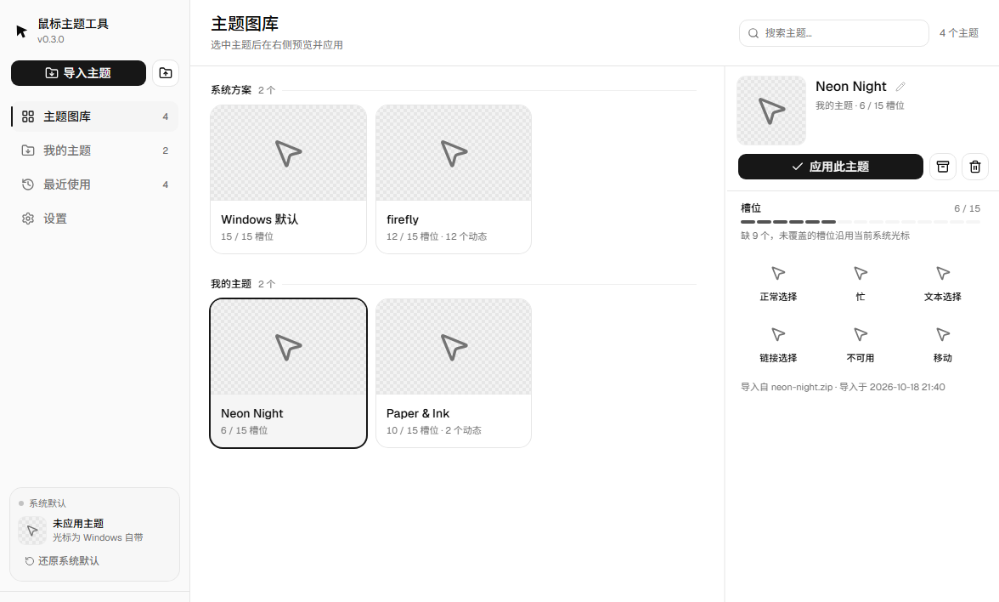
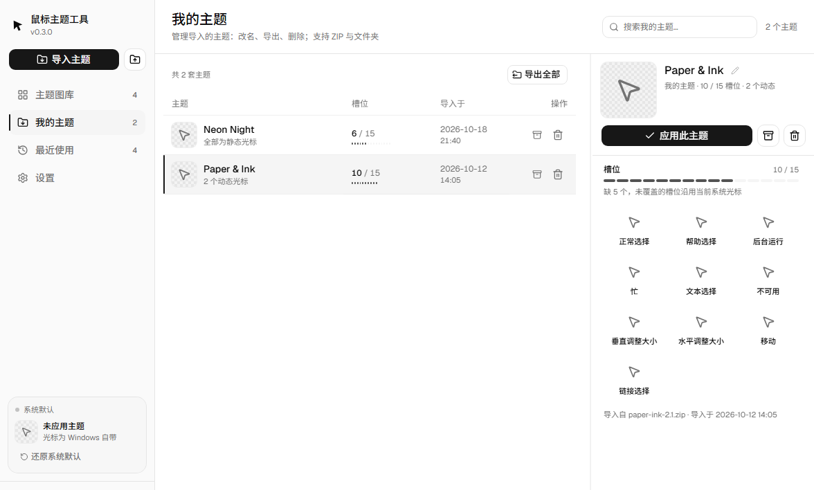
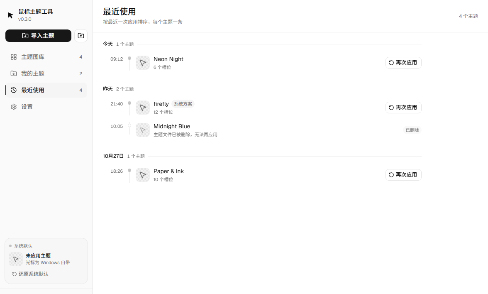
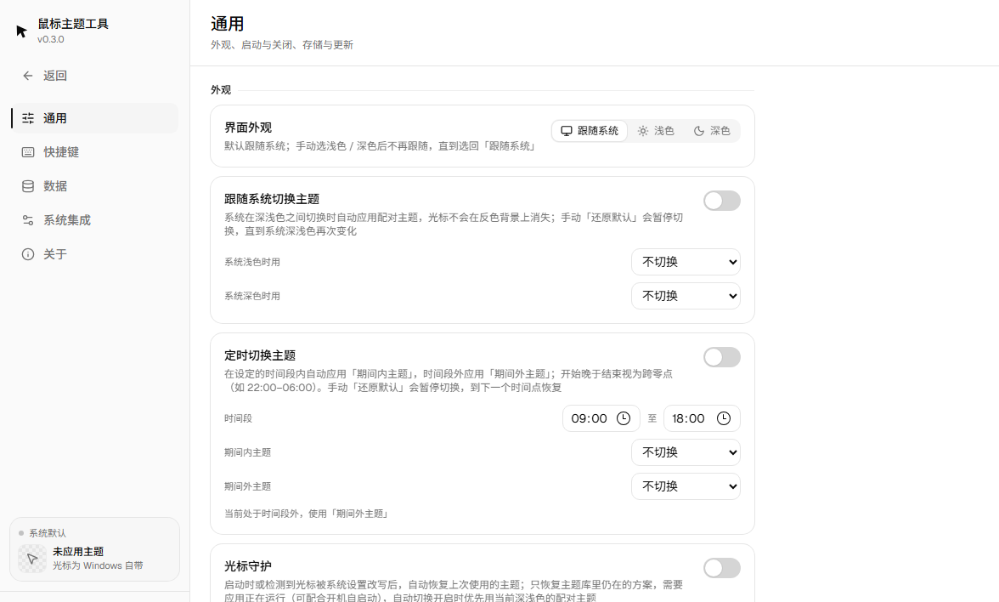

<p align="center">
  
</p>

<h1 align="center">鼠标主题工具</h1>

<p align="center">
  一个<strong>不需要管理员权限</strong>的 Windows 光标主题管理器<br />
  导入 <code>.zip</code> / <code>.theme</code> / <code>.themepack</code> / 主题文件夹 → 一键应用 → 管理、备份、回溯
</p>

<p align="center">
  <a href="https://github.com/XU-QiYi/mouseTool-theme/actions/workflows/ci.yml"></a>
  <a href="https://github.com/XU-QiYi/mouseTool-theme/releases/latest"></a>
  <a href="https://github.com/XU-QiYi/mouseTool-theme/releases"></a>
  <a href="https://github.com/XU-QiYi/mouseTool-theme/stargazers"></a>
  <a href="https://github.com/XU-QiYi/mouseTool-theme/commits/main"></a>
  <a href="https://github.com/XU-QiYi/mouseTool-theme/issues"></a>
  <a href="LICENSE"></a>
</p>

<p align="center">
  
  
  
  
  
  
</p>

---

## 截图

| 主题图库 | 我的主题 |
| --- | --- |
|  |  |
| **最近使用** | **设置** |
|  |  |

## 功能

### 导入：把现成的光标资产收进来

- **`.zip` 主题包**：侧栏「导入主题」选择，或直接拖进窗口
- **整个主题文件夹**：拖进来即可，与 zip 共用同一条落盘链路
- **`.theme` 光标方案**：Windows 个性化保存的方案、主题站分发的方案，按 `[Control Panel\Cursors]` 段对号 15 个槽位；引用系统光标或包外文件也能收编为普通主题（复制文件，源文件不动）
- **`.themepack` 主题包**：微软官方分装的 CAB 容器直接认，包内 `.theme` 方案优先于文件名推断；壁纸 / 声音等非光标内容不处理
- **`.inf` 说明书优先**：包内带安装说明时按说明书映射槽位；没带或解析失败才按 `arrow`、`busy`、`hand` 这类标准命名推断
- **右键菜单导入**（试点，默认关闭）：在 `.zip` / `.themepack` / `.theme` 文件上右键，一键送进应用

### 应用与还原

- 一次写入 15 个槽位并立即刷新系统光标，全程普通用户权限，**无 UAC**
- 光标文件留在 `%LOCALAPPDATA%` 原地，不复制进 `C:\Windows\Cursors`，也不写系统的「已保存方案」列表
- 随时「还原系统默认」，并清理 Win11 新指针键的残留
- 系统设置或其它工具改写光标后，状态卡会提示「光标已被系统设置修改」，重新应用任意主题即可夺回
- **保存并接管当前光标**：外部改写态下，一键把当前光标复制成「我的主题」并应用；有槽位没抄全时只保存并说明原因，不会把当前光标写坏
- **光标守护**（可选，默认关闭）：启动时或检测到外部改写后，自动恢复上次使用的主题

### 管理与维护

- 改名、导出、删除；导出的 zip 按槽位重命名，并附带通用 `.inf` 安装文件，保证「导出 → 再导入」能还原
- **回收站**：删除先移入回收站，可恢复、彻底删除或清空（上限 20 套 / 512 MB，超出自动清理最早）
- **文件完整性**：声明了但读不到的槽位文件，在「我的主题」、检查器与诊断中心提示「缺 N 个文件」；只提示不拦截
- **内容查重**：按槽位指纹预分组、组内逐字节确认，只报证实的重复，并算出删到每组一套能省多少空间
- **存储占用**：按主题库 / 备份 / 回收站 / 历史 / 设置分区域统计
- **批量导出**：一次导出「我的主题」全部套，单套失败不影响其余
- **清空使用记录**：只清历史事件，不碰主题与设置

### 备份：先看内容，再决定怎么恢复

- **手动备份**：一键打包全部主题与历史
- **自动备份**（可选，默认关闭）：每天一份进备份历史，按保留份数自动清理；手动备份不会被清理
- **内容浏览**：恢复前先看包里有哪些主题、各有多少槽位 / 文件、缺了什么
- **单主题恢复**：只把其中一套追加回主题库，不覆盖已有、不合并历史；部分缺文件仍可恢复并提示缺口
- **完整性体检**：逐份 CRC 校验，坏条目当场点名；结果是会话内快照，不会拿旧结论骗人
- **损坏防护**：恢复遇到坏数据时给出可照着行动的中文错误，并明确「本次恢复已全部撤销」；不做半套恢复
- **从文件恢复先看内容**：外部备份不再盲合，先看清单再决定逐套恢复还是整包合并

### 自动化与效率

- **回溯**：每次切换记一条历史，按自然日分组，可一键切回
- **跟随系统深浅色**：浅色 / 深色各配一个主题，系统切换或窗口回到前台时自动应用
- **定时切换**：按时间段自动应用「期间内 / 期间外」主题，支持跨零点窗口；时间段内有配置时优先于深浅色自动切换
- **托盘快速切换**：关闭到托盘后，托盘菜单直接列出最近使用的主题（最多 8 个）与「还原默认光标」
- **外观三态**：跟随系统 / 浅色 / 深色，可手动覆盖
- **预览**：静态 `.cur` 与动态 `.ani` 都能在界面里真实播放（Rust 提帧 → canvas 逐帧）

## 快速开始

### 下载安装

前往 [Releases](https://github.com/XU-QiYi/mouseTool-theme/releases/latest) 下载最新版本：

| 文件 | 说明 |
| --- | --- |
| `MouseThemeTool-0.3.0-x64-setup.exe` | Windows 安装包（推荐，双击安装；可直接覆盖安装） |
| `MouseThemeTool-0.3.0-x64-portable.exe` | 免安装版，下载即用 |

**系统要求**：Windows 10 / 11 x64（需 WebView2 运行时，Win11 自带）；界面仅简体中文。

> 本版本尚未购买代码签名证书，安装时可能看到「Windows 已保护你的电脑」。点击「更多信息」→「仍要运行」即可。安装包本身是安全的。

### 从源码运行

前置：[Node.js](https://nodejs.org/) 20+、[Rust](https://www.rust-lang.org/tools/install)、WebView2（Win11 自带）。

```bash
npm install
npm run tauri dev      # 开发（前端热更新 + Rust 增量编译）
npm run tauri build    # 打包
```

只想看界面、不碰系统光标：

```bash
npm run dev            # 浏览器打开 http://localhost:1420，走内置示例数据
```

### 导入一套主题

1. 把 `.zip` / `.themepack` / `.theme` 文件或整个主题文件夹拖进窗口
2. 在「主题图库」里选中主题，右侧检查器逐个槽位预览
3. 点「应用此主题」——光标立即生效，并记入「最近使用」

## 为什么不直接改 Windows 设置

| 痛点 | 这里的做法 |
| --- | --- |
| 系统设置只能一套一套换，看不出包里到底有几个光标 | 15 个槽位逐个预览，还标出这个包缺了哪几个 |
| 应用后想切回去，得自己记得上次叫什么 | 历史按天记着，点一下就回去 |
| 网上下载的包解压一堆 `.cur`，不知道该放哪 | 整个文件夹拖进窗口就行；`.zip` 也认。落盘、命名、槽位推断（`.inf` 说明书优先）都由程序做 |
| Windows 主题方案（`.theme`）里的光标用不上 | 拖进来就收编成我的主题：方案段键名与注册表槽位同名，直接对号复制 |
| 微软商店 / 主题站分发的 `.themepack` 打不开 | 直接拖进来：CAB 自动解档（限额与白名单全套生效），包内 `.theme` 方案对号槽位 |
| 系统设置会把光标整体改回去 | 光标守护（可选）在启动或检测到外部改写后自动恢复上次主题 |
| 改光标要动系统目录 | 只在 `HKCU` 写槽位路径，文件留在 `%LOCALAPPDATA%` |

## 数据与隐私

- 主题存在 `%LOCALAPPDATA%\CursorStudio\themes\<uuid>\{theme.json, cursors/}`
- 删除的主题先移入 `%LOCALAPPDATA%\CursorStudio\trash\`（可恢复；上限 20 套 / 512 MB，超出自动清理最早）
- 历史存在 `%LOCALAPPDATA%\CursorStudio\history.json`（事件流上限 200 条，界面按主题去重展示最近 50 个）
- 手动 / 自动备份存在 `%LOCALAPPDATA%\CursorStudio\backups\`（可整包恢复，也可只恢复其中一套主题）
- **卸载不删数据**；主题存储目录可在「设置 → 通用」里换到别处
- 应用**不上传**主题、历史或任何本地数据；只在「检查更新」时访问 GitHub Releases API（可在设置里关闭自动检查）

## 技术栈

| 层 | 选型 |
| --- | --- |
| 桌面容器 | [Tauri 2](https://tauri.app/)（Rust + WebView2） |
| 前端 | React 19 · TypeScript 5.8 · Vite 7 · Tailwind CSS 4 · shadcn/ui（[base-ui](https://base-ui.com)）· zustand 5 |
| 后端 | Rust（注册表读写、光标解码、归档导入 / 导出、备份、回收站） |

## 项目结构

```text
src/
├── components/
│   ├── layout/       骨架：侧栏、页头、分隔条、错误与空状态
│   ├── views/        四个视图：主题图库 / 我的主题 / 最近使用 / 设置
│   ├── theme/        主题卡片、检查器、改名与删除
│   └── cursor/       光标预览：单帧、动态播放
├── lib/              页面清单、槽位统计、外观三态、自动切换、光标守护、自动备份、定时切换
├── stores/           唯一全局状态
└── services/         invoke 封装 + 浏览器示例数据
src-tauri/
├── commands/         39 个命令：主题读取/导入/应用/保存当前/删除/改名/导出（含批量导出、内容查重）
│                     + 回收站 + 数据目录/存储统计/设置/系统集成/备份（含自动备份、内容浏览、
│                     单主题恢复、完整性体检）等
├── models/           前后端共用的数据结构
└── utils/            注册表、光标解码、主题导入（zip/.themepack/.theme/文件夹/.inf）、
                      路径相对化、目录迁移、回收站、捕获当前光标、历史
docs/                 决策记录、需求、架构、设计系统、动效、发布说明
```

## 文档

冲突时以顺序靠前的为准：

1. [`docs/mouse-theme决策记录.md`](docs/mouse-theme决策记录.md) —— 已拍板的决定
2. [`docs/mouse-theme需求描述.md`](docs/mouse-theme需求描述.md) —— 范围与边界
3. [`docs/mouse-theme架构设计.md`](docs/mouse-theme架构设计.md) —— 目录、命令契约、硬约束
4. [`docs/design-system.md`](docs/design-system.md) / [`docs/motion.md`](docs/motion.md) —— 视觉与动效
5. [`docs/mouse-theme发布指南.md`](docs/mouse-theme发布指南.md) —— 版本号同步与发布流程
6. [`docs/版本发布release/`](docs/版本发布release/) —— 各版本发布说明

## 已知限制

- 光标守护只恢复主题库里仍存在的方案，不保存 / 接管外部光标；应用没运行（且没开开机自启动）时不会恢复。要归档外部光标，用侧栏当前使用卡的「保存并应用」
- 不支持自制主题、单光标替换（**已拍板不做**）
- `.themepack` 支持常见的 MSZIP 压缩；LZX / Quantum 压缩的罕见老包会明确报错
- `.theme` / `.themepack` 方案里引用缺失、格式不对或指向当前机器不存在的系统光标时，只跳过对应槽位并提示；全部槽位落空才拒绝导入
- 选择对话框收 `.zip` / `.theme` / `.themepack`（不混选文件夹），文件夹导入走拖放（Tauri 对话框无法混选文件与文件夹）
- 无 BOM 的 GBK 编码 `.inf` 里，中文文件名解析为乱码（对应槽位自动退回文件名推断）
- 检查更新只提示新版本并给出下载入口，不自动下载安装
- 只有最小窗口尺寸兜底，不做响应式断点
- 仅支持 Windows 10 / 11 x64；应用依赖 Windows 注册表与光标 API

## 开发

```bash
npm run build                    # tsc + vite
cd src-tauri && cargo test       # 后端单测（临时目录 + 隔离注册表键，不碰真实光标）
cargo clippy --all-targets -- -D warnings
node scripts/design_audit.mjs    # 设计 token 审计（违规退出码 1）
node scripts/doc_ref_check.mjs   # 文档交叉引用是否指空
```

CI（[`.github/workflows/ci.yml`](.github/workflows/ci.yml)）在 `windows-latest` 上跑 `npm ci` → `npm run build` → `cargo test` → `cargo clippy -- -D warnings` → `design_audit` → `doc_ref_check`。

界面验收脚本跑在浏览器里、走示例数据，不会改系统光标；**必须与 dev server 写在同一条命令**：

```bash
node scripts/dev_bg.mjs start
node scripts/nav_check.mjs       # 三页结构签名
node scripts/design_check.mjs    # 焦点、检查器宽度、外观三态、删除链
node scripts/ui_check.mjs        # 点击 / 应用 / 删除链路
node scripts/future_check.mjs    # 诊断中心 / 备份历史 / 导入中心
node scripts/trash_check.mjs     # 回收站
node scripts/capture_check.mjs   # 保存并应用外部光标
node scripts/guard_check.mjs     # 光标守护
node scripts/integrity_check.mjs # 文件完整性
node scripts/auto_backup_check.mjs
node scripts/schedule_check.mjs
node scripts/backup_content_check.mjs
node scripts/backup_verify_check.mjs
node scripts/duplicate_check.mjs
node scripts/maintenance_check.mjs
node scripts/scheme_import_check.mjs
node scripts/dev_bg.mjs stop
```

完整的脚本清单、真机验证与发布步骤见 [`AGENTS.md`](AGENTS.md) 与 [`docs/mouse-theme发布指南.md`](docs/mouse-theme发布指南.md)。

## 许可证

[MIT](LICENSE) © 2026 XU-QiYi

---

<p align="center">
  遇到问题或有主题包想反馈？<a href="https://github.com/XU-QiYi/mouseTool-theme/issues">提交 Issue</a>
</p>
